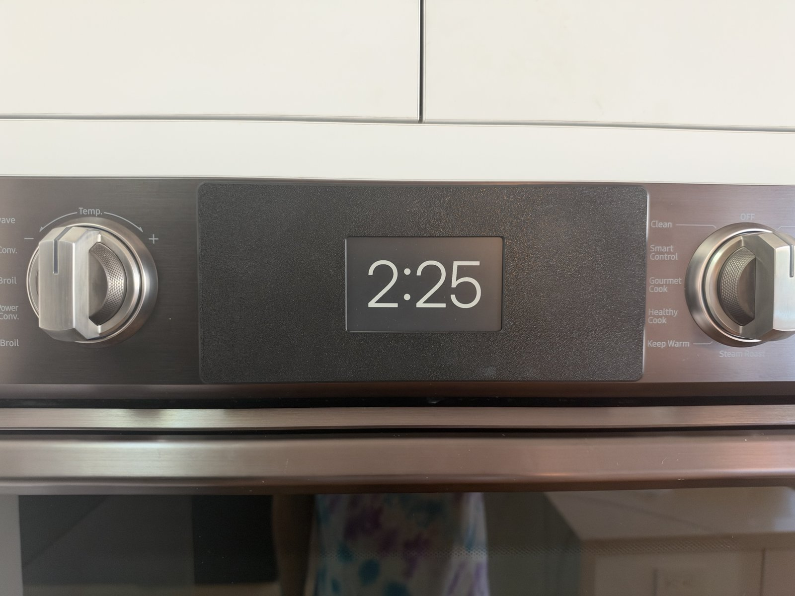
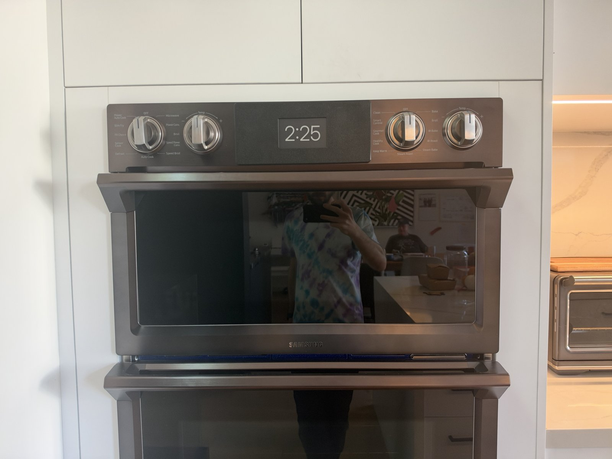
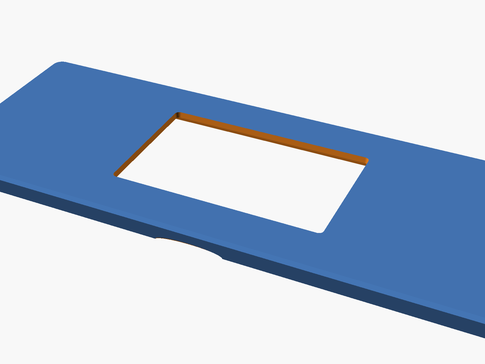

# Oven clock

A wall clock for a Samsung NQ70M7770 wall oven. A 3D-printed cover plate sits over the oven's control-panel glass, held on by magnets, and holds an [Xteink X4 Classic](https://www.xteink.com/) e-ink reader running clock-only firmware.

Why: the oven's built-in screen and clock stopped working. The knobs still run the oven, so this puts a working clock back where the old one was.

Print files and photos: [MakerWorld](https://makerworld.com/en/models/3561311-oven-control-panel-cover-with-e-ink-clock).








## What's here

| Folder | What it is |
| --- | --- |
| `plate/` | The cover plate model, current version v5: `oven-plate.scad` (OpenSCAD source) and `oven-plate.stl`. |
| `plate/print/` | **What to print:** `oven-plate-v5-H2C-PLA.gcode.3mf` (H2C, PLA, gyroid 15%), plus the print-orientation files. |
| `plate/versions/` | Earlier versions, v1–v4, with their print files (v3 also has an X1C file, rotated 45° to fit that bed). |
| `firmware/` | The clock firmware: a fork of [papyrix-reader](https://github.com/bigbag/papyrix-reader) by bigbag (MIT), with its full history. |
| `tools/` | `make-clock-font.py`, which turns a TTF into the clock's digit bitmaps. |
| `images/` | Renders of the plate and the clock face. |

## The plate

- Fits the oven's dark control panel (119 mm tall) with 1.5 mm to spare at top and bottom: the plate is 116 mm tall.
- The window lines up with the 90 mm black glass. The magnet slots sit on the metal trim above and below the glass, 1 mm from its edge.
- Magnets go in pairs: one stuck to the oven trim, one glued into the plate.
- The PLA files are for test fits. Print the final plate in PETG or ASA, since it sits on an oven.
- There's no X1C file for v5 yet; the v3 one shows the 45° layout that fits that bed.

## The firmware

Changes from papyrix-reader (all in `firmware/src/apps/` and `firmware/src/main.cpp`):

- Boots straight into the clock app instead of the reader's home screen.
- Shows the time in landscape (power button on the right), 12-hour, US Pacific time with daylight saving time worked out in firmware (`ClockFrame.cpp`).
- Default face "Modern": Inter Display Light digits, white on black. "Modern light" (black on white) and "Segment" (seven-segment digits) can be picked under Face in the clock settings.
- Syncs the time over Wi-Fi each time it starts, then once a day. Between minutes it sleeps, and the reader's real-time clock keeps time.
- Stays awake while plugged into USB, which makes flashing easy.
- The battery icon only appears below 15%.
- Reports its battery level to Home Assistant each time it syncs (see below).

### Battery reports to Home Assistant

Each time the clock syncs the time it is already on Wi-Fi, so it also POSTs its battery level to a Home Assistant webhook. That adds about a second of Wi-Fi time, at most 3 seconds if Home Assistant doesn't answer, and a failed report is ignored (`firmware/src/apps/ClockReport.cpp`).

- Put the webhook URL on one line in `/.papyrix/apps/homeassistant.txt` on the microSD card, e.g. `http://192.168.2.195:8123/api/webhook/<webhook id>`. Plain `http://` on the home network only (no HTTPS). With no file, the clock sends nothing.
- The body is JSON: `{"battery":57,"millivolts":3850,"charging":false,"usb":false,"rssi":-61,"version":"1.37.0-dev"}` (`-1` when a value can't be read).
- Reports follow the Auto sync setting (every 3, 6 or 24 hours).
- Home Assistant side: a trigger-based template sensor on that webhook (`local_only: true`), plus alerts below 20% and 10% and when nothing has arrived for 50 hours.

Wi-Fi networks are set up on the device (Settings › Wi-Fi) and saved on its microSD card.

### Build and flash

PlatformIO needs Python 3.10–3.14.

```bash
cd firmware
pio run -e x4c
esptool --chip esp32s3 --port /dev/cu.usbmodem1101 --baud 921600 write-flash 0x10000 .pio/build/x4c/firmware.bin
```

If the reader is asleep and doesn't show up over USB, take out the microSD card and press power. It stays awake on an error screen and can be flashed. Then put the card back and reset it.

Back up the stock firmware before flashing for the first time (`esptool read-flash 0 0x1000000 backup.bin`).

### Changing the font

```bash
python3 tools/make-clock-font.py path/to/font.ttf firmware/src/apps/fonts/ClockFontInter.h preview.png
```

The script picks the largest size where the widest time still fits the screen.

## Licenses

- Firmware: MIT, from papyrix-reader (see `firmware/LICENSE`).
- Inter font: SIL Open Font License 1.1 (see `firmware/src/apps/fonts/Inter-LICENSE.txt`).
- Plate files and tools: MIT.
